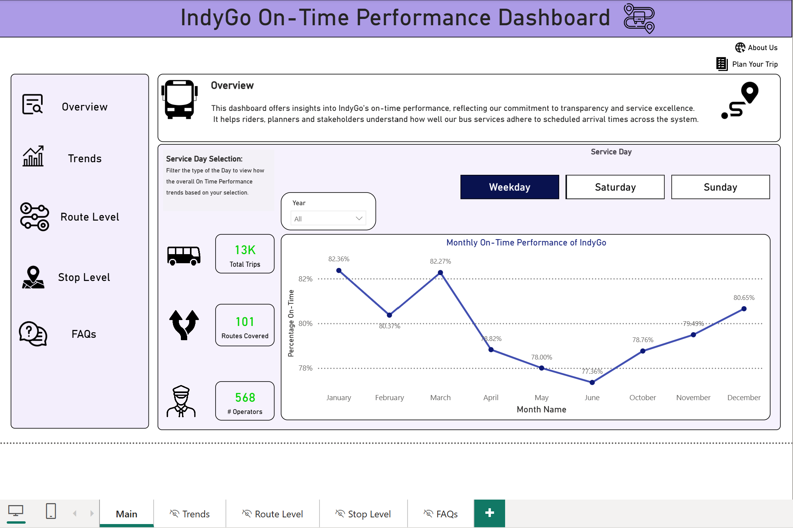
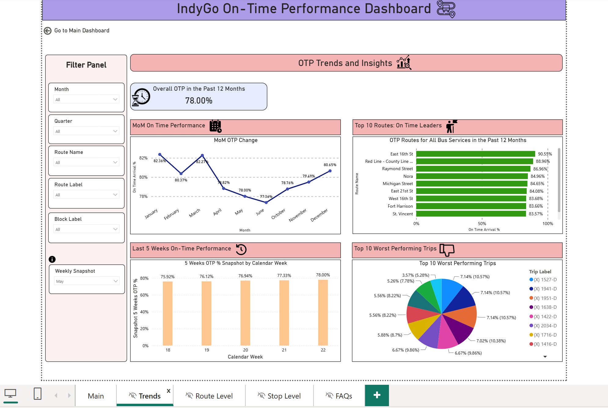
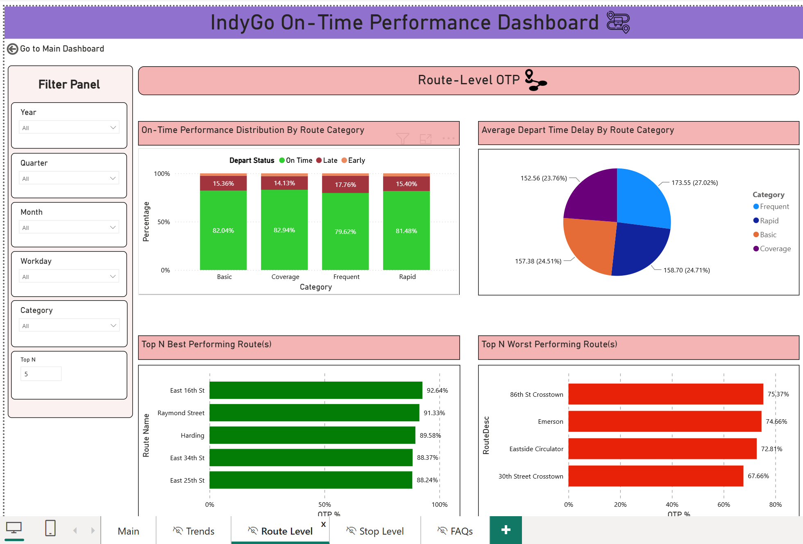
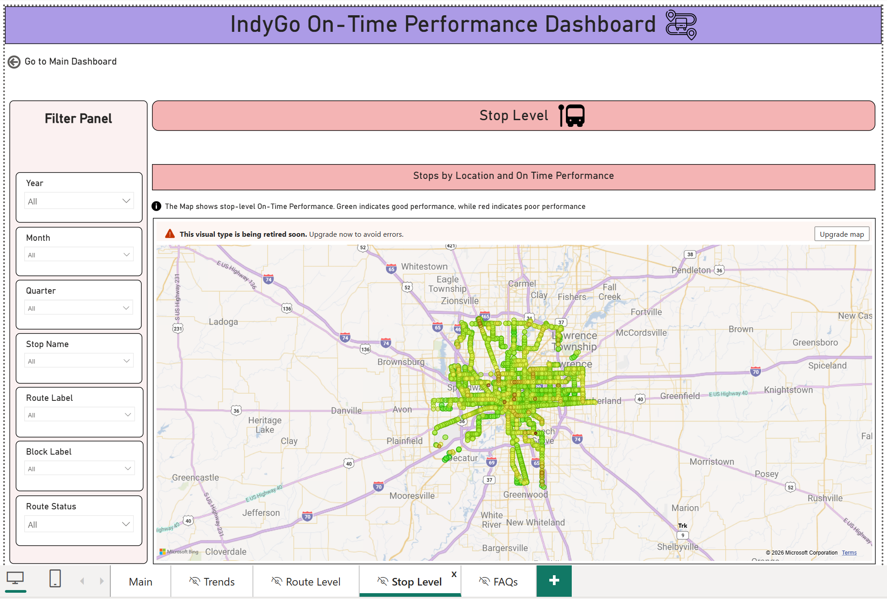
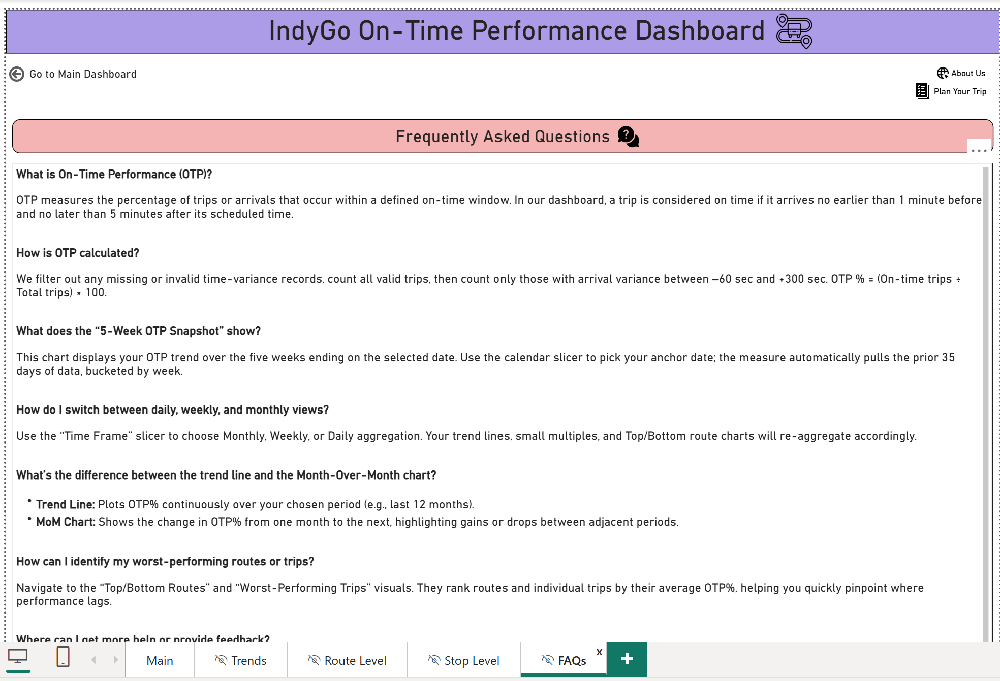

# IndyGo On-Time Performance Dashboard

An interactive **Power BI dashboard** for analyzing IndyGo bus on-time performance across time periods, service-day types, routes, route categories, trips, and stop locations.

This project was created as part of an **Indiana University Information Visualization client project**. The dashboard was designed to make transit performance easier to explore for riders, planners, and other stakeholders through interactive filtering, trend analysis, route-level comparisons, and stop-level geographic views.

---

## Dashboard Preview

### Main Dashboard



The landing page provides a high-level view of IndyGo's on-time performance, including:

- Overall monthly on-time performance trend
- Total trips
- Routes covered
- Number of operators
- Service-day selection for **Weekday, Saturday, and Sunday**
- Year-level filtering
- Navigation to deeper analytical views

---

## Project Objective

Public transit performance data can be difficult to interpret when users must work directly with large operational datasets.

The goal of this project was to build a dashboard that allows users to quickly answer questions such as:

- How is IndyGo's on-time performance changing over time?
- Which routes consistently perform well or poorly?
- How does performance differ across service categories?
- Which individual trips have the lowest on-time performance?
- Where are lower-performing stops geographically concentrated?
- How does performance change by year, month, quarter, workday, route, or service type?

---

## On-Time Performance Definition

A trip is classified using its variance from the scheduled time:

| Status | Definition |
|---|---|
| **Early** | More than 1 minute early |
| **On Time** | Between 1 minute early and 5 minutes late |
| **Late / Delayed** | More than 5 minutes late |

The dashboard calculates **On-Time Performance (OTP)** as the percentage of valid trips that fall within the defined on-time window.

---

## Dashboard Pages

### 1. Main Dashboard

The main page gives users an immediate overview of system-wide performance.

**Key components**

- Monthly OTP trend
- Service-day selector
- Year filter
- KPI cards for trips, routes, and operators
- Persistent dashboard navigation


---

### 2. Trends & Insights

The Trends page provides a deeper view of how OTP changes over time.

**Key analyses**

- Overall OTP for the previous 12 months
- Month-over-month performance trend
- Five-week OTP snapshot
- Top-performing routes
- Worst-performing individual trips
- Filters for month, quarter, route, route label, and block



This view helps identify both long-term changes and shorter-term shifts in transit reliability.

---

### 3. Route-Level Analysis

The Route-Level page compares performance across IndyGo routes and service categories.

**Key analyses**

- On-time performance distribution by route category
- Early, on-time, and late trip distribution
- Average departure delay by route category
- Top-N best-performing routes
- Top-N worst-performing routes
- Dynamic filtering by year, quarter, month, workday, category, and Top-N value



The dashboard supports route categories such as:

- Basic
- Coverage
- Frequent
- Rapid / BRT

---

### 4. Stop-Level Analysis

The Stop-Level page provides a geographic view of on-time performance across IndyGo stops.

**Key features**

- Interactive stop-level map
- Stop performance encoded geographically
- Filters for year, month, quarter, stop, route, block, and route status
- Ability to identify geographic areas with stronger or weaker service performance



This view helps connect operational performance to actual transit locations across the Indianapolis service area.

---

### 5. FAQs & Metric Definitions

The dashboard also includes a dedicated FAQ page so users can understand how metrics are calculated and how different views should be interpreted.

Topics include:

- What On-Time Performance means
- How OTP is calculated
- How the five-week snapshot works
- How to switch between daily, weekly, and monthly analysis
- Difference between trend and month-over-month views
- How to identify worst-performing routes and trips



---

## Key Features

- **Interactive Power BI experience** with cross-filtering and slicers
- **Multi-level analysis** from system-wide trends down to routes, trips, and stops
- **Time-based analysis** across monthly and rolling periods
- **Top-N route analysis** for identifying best and worst performers
- **Geospatial stop analysis**
- **Route-category comparisons**
- **Dynamic navigation** across dashboard pages
- **User-facing metric documentation** through an embedded FAQ experience
- **QA-focused metric validation** to ensure dashboard values remain aligned with source data

---

## Tools & Technologies

- **Power BI**
- **DAX**
- **Power Query**
- **Data Modeling**
- **Python**
- **Excel**
- **Data Visualization**
- **UX Design**
- **Dashboard QA / Validation**

---

## Data Model

The project uses transit operational data containing identifiers and performance fields such as:

- Date
- Route
- Trip
- Stop
- Scheduled and actual timing
- Departure / arrival variance
- Route category
- Service-day information

The underlying dataset was large enough that data volume and Power BI service capacity became an important implementation consideration.

---

## UX & Design Approach

The dashboard was designed around progressive exploration:

**System Overview → Trends → Route-Level Analysis → Stop-Level Analysis**

A persistent navigation structure allows users to move between analytical levels without losing the overall context of the dashboard.

Design priorities included:

- Clear information hierarchy
- Consistent page structure
- Easy-to-understand filters
- Reusable visual patterns
- Accessible metric definitions
- Minimal navigation friction
- Separation between summary KPIs and deeper diagnostics

---

## Quality Assurance

Because on-time performance metrics can change significantly based on filtering and time-window definitions, validation was an important part of the project.

QA included:

- Verifying OTP calculations against source data
- Checking filtering behavior across dashboard pages
- Validating route and trip rankings
- Testing interactions between slicers and visuals
- Reviewing navigation and page consistency
- Ensuring metric definitions were communicated clearly to users

---

## Example Insights

The dashboard enables users to identify:

- Changes in system-wide OTP over time
- Differences in performance between route categories
- Best and worst-performing routes
- Trips with consistently low OTP
- Stop-level geographic performance patterns
- Short-term changes through rolling weekly snapshots

The purpose of the dashboard is not only to visualize performance, but also to help users identify **where service reliability is changing and where further investigation may be needed**.

---

## Repository Structure

```text
indygo-on-time-performance/
│
├── README.md
├── IndyGo_On_Time_Performance.pbix
│
└── screenshots/
    ├── main-dashboard.png
    ├── trends-dashboard.png
    ├── route-level-dashboard.png
    ├── stop-level-dashboard.png
    └── faq-dashboard.png
```

---

## Running the Dashboard

1. Download the `.pbix` file from this repository.
2. Install **Microsoft Power BI Desktop**.
3. Open the PBIX file in Power BI Desktop.
4. Navigate between the dashboard pages using the built-in navigation.
5. Use the slicers and filters to explore the data interactively.

---

## Project Team

**Team Ready2Go**

- Soon-Hyuck Lee — UX Designer
- Abhay Singh — Visualization Developer
- Pratham Dedhiya — QA
- **Yash Vyas —  Data Analyst**

**Project Sponsor:** Satya Sarfare, Business Data Analyst working with IndyGo

---
